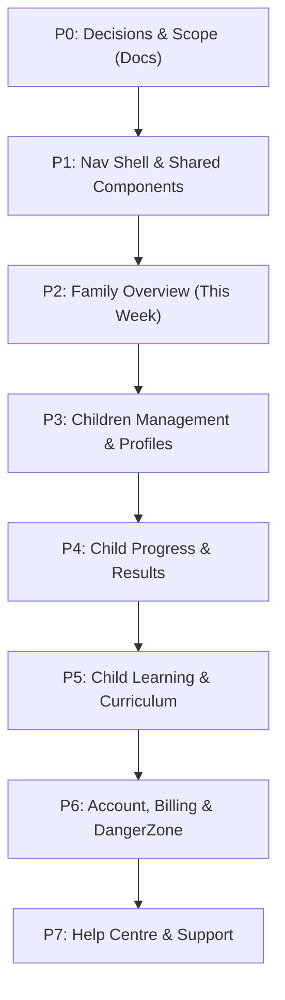

# Parent Journeys — P0 Trace, Decisions & Implementation Scope

**Date:** 8 November 2026  
**Base:** `origin/dev` @ `17d8be2fcf81ab456980b24a65d4da0bc38950b2`  
**Scope:** Documentation only. Technical trace of backend dependencies, product decisions (P1–P14), screen inventory (35 artboards across 7 journeys), component contracts, and implementation plan for the MindMosaic Parent Journey redesign.  
**Design Reference:** `Claude outputs/mindmosaic-parent-journey.html` (artboards `b1`–`b35`, components `b32`, decisions `b33`, backend dependencies `b34`).  
**Evidence Rule:** Every technical verdict cites exact file paths and line ranges on this base. `BUILT ALREADY` = code exists and is supported today. `NEEDS A BUILD` = code is missing or requires new routes/handlers. `NEEDS SIGN-OFF` = product/legal decision required outside engineering.

---

## 1. Non-Negotiable Honesty Rules

MindMosaic is an educational platform relied upon by students and their parents. The following rules govern all parent-facing screens and components without exception:

1. **Server Confirmation Gate:** Never state that anything is *saved*, *submitted*, *marked*, or *updated* until the server has explicitly acknowledged the transaction with a 2xx response. This applies to child profiles, PIN generations, email changes, preferences, and support inquiries.
2. **No Performance Bands (Decision D-P4):** The parent screens must never display a performance band (e.g. "Exceeding", "Strong", "Good", "Building", "Needs practice"). `performanceBand()` must not be called. Scores are reported strictly as *marks earned out of marks available*, alongside the exact number of papers behind them.
3. **Evidence Floor for Claims (Decision P3):** Any statement or evaluative claim about a child requires a strict minimum evidence floor of **≥2 completed papers and ≥8 marks**. Below this floor, the claim is withheld and the screen explicitly states: *"Not enough yet to say anything about a single strand. It needs 2 finished papers and 8 marks."* Never infer a level, trend, or relative strength.
4. **Isolated Parent Previews (Decision P8):** Any practice paper or lesson viewed by a parent under "Support learning" is explicitly marked as a preview session (`preview=true`). It must **never** record an attempt, affect marks, or contaminate the child's data.
5. **No Speculative Retention or Processing Times (Decision P11):** No screen may state an unverified turnaround, data retention duration, or deletion timeframe. Deletion requests and data copy notices describe what will happen, never a false deadline.
6. **Honest Partial-Failure States:** The family summary endpoint (`src/features/parent-dashboard/summary.ts`) computes and returns `unreadableRowCount`. When this count is non-zero, the UI must render an honest partial-failure status (*"Some of this week's activity couldn't be read"*) rather than silently under-reporting marks.
7. **Reuse Existing Backend Infrastructure:** Build on the existing authenticated services, RLS policies, and Postgres models. Do not reinvent what is already tested.

---

## 2. Product Decisions (P1–P14) & Chosen Positions

Fourteen design decisions were established in the parent journey specification (`Claude outputs/mindmosaic-parent-journey.html#b33`). The positions below govern the implementation across all phases:

| # | Topic | Status | Chosen Position & Implementation Policy |
|---|---|---|---|
| **P1** | **Navigation & Shell (D-P1)** | **ACCEPTED** | **Top-level nav is 3 items: "This week" (`/parent`), "Children" (`/parent/children`), and "Account" (`/parent/account`).** Billing lives inside Account (`/parent/account#billing` or via a direct link to `/billing`). Help is reachable from the universal header. Curriculum Explorer and Writing move inside child-scoped routes: `/parent/children/[childId]/curriculum` and `/parent/children/[childId]/writing`. Existing top-level routes (`/parent/curriculum-explorer`, `/parent/writing`) redirect to the default/active child. |
| **P2** | **Overview Heading vs Nav** | **ACCEPTED** | **Nav item is "This week"; page heading is "Family Overview".** The nav item signals recency; the page heading signals scope across all children. |
| **P3** | **Claim Evidence Floor** | **ACCEPTED** | **Requires ≥2 finished papers and ≥8 marks.** Below this floor, the evaluative claim is withheld and real counts are stated. This threshold matches the student journey constant (`MIN_COMPLETED_PAPERS = 2`, `MIN_SCORED_MARKS = 8`), ensuring consistency across student and parent views. |
| **P4** | **Performance Bands (D-P4)** | **ACCEPTED** | **Zero performance bands rendered on parent screens.** Scores are shown as marks earned out of marks available (`X of Y marks`). Evaluative bands ("Strong", "Developing", etc.) are completely omitted. *(See Section 6 for follow-up on landing page).* |
| **P5** | **Paid Places vs Profiles** | **ACCEPTED** | **Paid places and child profiles are decoupled.** A subscription purchases active seat capacity. A child profile is an enduring historical record. Running out of places disables active practice access for that profile but never deletes data or charges silently. |
| **P6** | **Pausing vs Deletion** | **Pausing BUILT / Deletion NEEDS A BUILD** | **Pausing is archive; deletion UI and erasure-request API are a P6 build.** Pausing is a reversible deactivation (archive) via `setChildArchived` in `src/features/parent-dashboard/child-access.ts` through `PATCH /api/parent/children/[childId] { archived: true\|false }`. Deletion is not a self-service button; it is an administrative 30-day verified erasure request. The underlying database migrations (`supabase/migrations/20260817090000_erasure_requests.sql` and `…_erasure_processor.sql`) exist, but no deletion UI or erasure-request API exists yet; P6 builds the deletion UI and request path on top of `erasure_requests`. |
| **P7** | **Student PIN Security** | **BUILT ALREADY** | **The 6-digit PIN is displayed exactly once upon creation or reset**, only after server confirmation. It is stored as a secure hash; recovery is via a fresh reset, never plaintext retrieval. |
| **P8** | **Practice Previews** | **ACCEPTED** | **Previews are isolated from student analytics.** When a parent explores practice questions under Support Learning, the session runs in preview mode with zero persistence to student attempt tables. |
| **P9** | **Assigning Practice** | **PROPOSED POLICY** | **Not built in this stack.** Rendered as a disabled proposal card in the Learning preview interface, avoiding coercive homework paradigms. |
| **P10** | **Stretch Content** | **PROPOSED POLICY** | **Not built in this stack.** Rendered as a disabled proposal card until cross-year curriculum scoring and attribution policies are formalized. |
| **P11** | **Retention & Deletion Timelines** | **ACCEPTED** | **No time promises stated.** Copy clearly articulates the workflow without fabricating specific SLAs (e.g., "30 days") until legally ratified. |
| **P12** | **Notification Settings** | **ACCEPTED** | **Billing notices cannot be disabled.** Transactional receipts and payment failure notices are mandatory; marketing and progress summaries are opt-in. |
| **P13** | **Support Ticket Reference** | **ACCEPTED** | **Reference ID is displayed only after the server acknowledges receipt.** Prevents client-side fabrication of support tickets. |
| **P14** | **Guardian Authority** | **BUILT ALREADY** | **Either linked guardian may pause or restore access.** Operates as shared account-level authority under the current data model. |

---

## 3. Screen & State Inventory (35 Artboards across 7 Journeys)

The design specification establishes 35 artboards across 7 core journeys. All screens follow the universal responsive reflow rule:
- **Desktop (1440px):** Two-column wrapping layout with main content and a min-width side rail (activity/context).
- **Tablet (834px):** Side rail drops below the main content column; both reflow to full width.
- **Mobile (390px):** Single-column stacked layout, child switcher scrolls horizontally, touch targets maintain a minimum of 44×44px.

| Journey | Artboard ID | Title | Breakpoint | Target Route | Primary Component / Module |
|---|---|---|---|---|---|
| **1. Setup** | `b1` | Welcome and add a child | 1440px | `/parent/setup` | `ParentSetupWizard` |
| | `b2` | Welcome — tablet | 834px | `/parent/setup` | `ParentSetupWizard` (stacked rail) |
| | `b3` | Welcome — mobile | 390px | `/parent/setup` | `ParentSetupWizard` (single column) |
| | `b4` | Child created | 1440px | `/parent/setup` | `ChildCreatedConfirmation` (PIN reveal) |
| | `b5` | Setup states | 1440px | `/parent/setup` | Unconfirmed email, validation error, duplicate name |
| **2. Overview** | `b6` | Family Overview | 1440px | `/parent` | `ParentOverview` (`ThisWeekView`) |
| | `b7` | Family Overview — tablet | 834px | `/parent` | `ParentOverview` (tablet reflow) |
| | `b8` | Family Overview — mobile | 390px | `/parent` | `ParentOverview` (mobile card stack) |
| | `b9` | First visit (no attempts) | 1440px | `/parent` | `ParentOverviewEmptyState` |
| | `b10` | Overview states | 1440px | `/parent` | Loading, below floor, partial failure, offline |
| **3. Children** | `b11` | Children | 1440px | `/parent/children` | `ChildrenDirectory` (profiles vs places) |
| | `b12` | Children — tablet | 834px | `/parent/children` | `ChildrenDirectory` (stacked) |
| | `b13` | Children — mobile | 390px | `/parent/children` | `ChildrenDirectory` (mobile cards) |
| | `b14` | A child’s profile | 1440px | `/parent/children/[childId]` | `ChildProfileDetail` (access, PIN reset, pause) |
| | `b15` | Children states | 1440px | `/parent/children/[childId]` | PIN reset confirm/reveal, limit reached, paused |
| **4. Progress** | `b16` | Child progress | 1440px | `/parent/children/[childId]/progress` | `ChildProgressDashboard` (filters, marks by strand) |
| | `b17` | Child progress — mobile | 390px | `/parent/children/[childId]/progress` | `ChildProgressDashboard` (compact tiles) |
| | `b18` | A result | 1440px | `/parent/children/[childId]/results/[id]` | `AttemptResultSummary` (marks earned vs pending) |
| | `b19` | Answer review | 1440px | `/parent/children/[childId]/results/[id]/review` | `AttemptAnswerReview` (correct/incorrect/pending) |
| | `b20` | Progress states | 1440px | `/parent/children/[childId]/progress` | Below floor, zero attempts, unreadable rows |
| **5. Learning** | `b21` | Learning for a child | 1440px | `/parent/children/[childId]/curriculum` | `ChildCurriculumHub` (curriculum alignment) |
| | `b22` | Learning — mobile | 390px | `/parent/children/[childId]/curriculum` | `ChildCurriculumHub` (mobile cards) |
| | `b23` | Preview | 1440px | `/parent/children/[childId]/preview` | `PracticePreviewModal` (assign/stretch proposals) |
| | `b24` | Learning states | 1440px | `/parent/children/[childId]/curriculum` | Ready, not written yet, check failed |
| **6. Account** | `b25` | Account | 1440px | `/parent/account` | `ParentAccountDashboard` (profile, security, plan) |
| | `b26` | Account — mobile | 390px | `/parent/account` | `ParentAccountDashboard` (stacked) |
| | `b27` | Account states | 1440px | `/parent/account` | Email change, password update, session list |
| | `b28` | Plan & billing handoff | 1440px | `/parent/account#billing` | `BillingHandoffPanel` (Stripe portal link) |
| | `b29` | Danger zone & deletion | 1440px | `/parent/account` | `DangerZone` (to build in P6; ADR-012 30-day verified request) |
| **7. Help** | `b30` | Help Centre | 1440px | `/parent/help` | `ParentHelpCenter` (6 curated topics) |
| | `b31` | Help Centre — mobile | 390px | `/parent/help` | `ParentHelpCenter` (compact topics) |
| | `b32` | Article and contact | 1440px | `/parent/help/[slug]` | `HelpArticleView` + `SupportContactForm` |
| | `b33` | Contact states | 1440px | `/parent/help/contact` | Submitting, confirmed with reference, error |
| **Reference** | `b34` | Reusable components | 1440px | Spec reference | Component library and accessibility rules |
| | `b35` | Backend dependencies | 1440px | Spec reference | Audit of existing vs missing backend code |

---

## 4. Reusable Component Contracts & Interaction Rules

The parent interface is constructed from five core components (`Claude outputs/mindmosaic-parent-journey.html#b32`):

### 4.1 Child Switcher (`ChildSwitcher.tsx`)
- **Structure:** `All children` pill, followed by individual child pills showing child initial avatar and name.
- **Rules:** Must appear exactly once per page; never buried inside a dropdown menu.
- **Accessibility:** Minimum 44×44px touch targets; active pill carries `aria-current="page"`. Active state clearly identifiable by color and typography.

### 4.2 Claim with Evidence (`ClaimWithEvidence.tsx`)
- **Structure:** Evaluative headline (e.g. "Going well: Number and algebra"), paired with strict evidence counts ("3 papers · 26 marks counted").
- **Floor Rule:** If completed papers < 2 OR counted marks < 8, the evaluative claim is suppressed. The component displays:
  > *"Not enough yet to say anything about a single strand. It needs 2 finished papers and 8 marks."*

### 4.3 Marks, Never Percentages (`MarksMeter.tsx`)
- **Structure:** Content reads explicitly as *"41 of 60 marks"*, supported by *"3 papers · 60 marks counted"*.
- **Visuals:** Progress bar is purely decorative and explicitly marked with `aria-hidden="true"`. Screen readers announce only the verifiable mark ratio.

### 4.4 Four Distinct State Blocks
Four standardized state blocks with mutually exclusive visual identity, semantic role, and copy:
1. **Loading:** Spinner/skeleton with `role="status"` and *"Checking this week's practice..."*
2. **Nothing Yet:** Empty state indicating child facts (*"Nothing finished yet. Once Aisha completes a paper, her work will appear here."*).
3. **Not Enough Yet:** Below evidence threshold (*"Not enough yet to show trends. 1 paper completed; needs at least 2."*).
4. **Could Not Load:** System error state (*"We couldn't load this section. Nothing has changed on your account."*).

### 4.5 Accessibility & WCAG Baseline
- **Touch Targets:** Minimum 44×44px for all interactives (buttons, switcher pills, avatar selectors, help triggers).
- **Focus Indicators:** 2px brand outline with 6px soft ring (`focus-visible:ring-4`), never removed.
- **Forms & Inputs:** Explicit `<label>` associations; invalid fields set `aria-invalid="true"` and reference descriptive messages via `aria-describedby`.
- **Status Messaging:** Polite live regions (`role="status"`) for asynchronous updates; assertive regions (`role="alert"`) for financial, access, or PIN changes.
- **Zoom & Reflow:** Clean horizontal reflow up to 200% zoom without horizontal clipping.

---

## 5. Backend Dependency Matrix

Audit of backend services on `origin/dev` (`Claude outputs/mindmosaic-parent-journey.html#b34`):

### 5.1 Built & Supported in Codebase (`BUILT ALREADY`)

| Feature | Codebase Location | Capabilities & Behavior |
|---|---|---|
| **Child Provisioning** | `src/features/auth/provision-child.ts` | Handles name, year level, curriculum, and PIN. Detects and flags duplicate names requiring explicit parent confirmation. |
| **Student Alias & PIN** | `src/features/auth/student-alias.ts` | Formats 8-character student code (`XXXX-XXXX`) and generates 6-digit PIN. Hashes PIN for storage. |
| **Child Access & Pausing** | `src/features/parent-dashboard/child-access.ts` | Reversible deactivation (archiving) preserving student history and guardian links. Per-child pause/restore is `PATCH /api/parent/children/[childId] { archived: true\|false }` (and `DELETE` archives) via `setChildArchived`. Pause-all has no endpoint (needs a build or client loop). |
| **Subscription & Plan Limits** | `src/lib/billing/prices.ts` | Defines `FAMILY_PLAN.maxChildren = 3`. Note: `prices.ts` defines only a Family plan; there is no Individual plan in code. |
| **Family Summary** | `src/features/parent-dashboard/summary.ts` | Aggregates finished papers, objective marks earned/available by subject, 7-day activity strip, and `unreadableRowCount`. |

### 5.2 Unbuilt Dependencies & Architectural Mitigations (`NEEDS A BUILD`)

| Missing Capability | Impact on Design | Phase Strategy & Mitigation |
|---|---|---|
| **Verified Account Deletion & Erasure API** | No component or deletion API exists today; only the DB migrations `20260817090000_erasure_requests.sql` and `…_erasure_processor.sql` exist. | **P6:** Build the request path (writes an `erasure_requests` row → processor) and the `DangerZone` UI following ADR-012. |
| **Pause-All Children Endpoint** | No bulk pause endpoint exists (`POST /api/parent/children/pause` does not exist). | **P6 / P3:** Build dedicated bulk route or iterate per-child `PATCH` calls from client. |
| **Notification Engine & Preferences** | Email dispatch (paper complete, weekly summary) does not exist; no database table for preferences. | **P6:** Render notification controls with honest disabled status or client-side acknowledgment; do not claim emails are sent. |
| **Data Export Service** | No endpoint generates GDPR/privacy data archives. | **P6:** Present data export as an out-of-band support request matching the ADR-012 model. |
| **Session Management Surface** | Supabase tracks active auth sessions, but no API surfaces "Active on 3 devices" or remote sign-out. | **P6:** Display account security options with honest current-session indication only. |
| **Help Centre Full-Text Search** | Knowledgebase search backend does not exist. | **P7:** Implement curated 6-topic browsing with direct email support contact. |
| **Support Message Endpoint** | No database table or webhook for parent support tickets. | **P7:** Implement `/api/parent/support` route generating a server-confirmed receipt reference. |
| **Per-Attempt Response Review** | Student attempt review route is not yet fully plumbed to server-stored questions. | **P4:** Show score and metadata breakdown; link to review route only when available. |

---

## 6. Open Items & Follow-Up Technical Debt

### 6.1 `performanceBand()` in Landing Page Progress (`chapter4-progress.ts`)
- **Inspection Finding:** `src/features/landing/chapter4-progress.ts` (lines 148–201) executes `performanceBand(percentage)` to assign "Strong", "Good", or "Developing" labels to individual practice sessions:
  ```ts
  const readingBand = performanceBand(readingPct);
  const numeracyBand = performanceBand(numeracyPct);
  ```
- **Architectural Conflict:** This assigns evaluative bands off a single paper without an evidence floor, conflicting with the honesty rule and Decision P4.
- **Resolution:**
  - **Within Parent Journey Stack:** Strictly excluded. No parent route or component will import or call `performanceBand()`.
  - **Open Follow-Up Item:** Logged as technical debt for the landing page (`src/features/landing/`). A future landing page audit should align Chapter 4 with the evidence floor rules.

### 6.2 ADR-012 Deletion Model (Design Intent for P6 Build)
- **Inspection Finding:** On `origin/dev`, no `DangerZone.tsx` component or erasure-request API exists. The underlying database tables and processor exist in `supabase/migrations/20260817090000_erasure_requests.sql` and `…_erasure_processor.sql`.
- **Resolution:** In Phase P6 (Account), a `DangerZone` UI and erasure request API will be built from scratch following ADR-012:
  - Account deletion is an explicit request recorded in `erasure_requests` with out-of-band verification and a 30-day grace period.
  - Pausing all children will be handled either via a new bulk endpoint or by looping per-child `PATCH /api/parent/children/[childId] { archived: true }`.

### 6.3 Subscription Plans (Individual vs Family)
- **Inspection Finding:** `src/lib/billing/prices.ts` defines only `FAMILY_PLAN` (`maxChildren: 3`). There is currently no Individual plan in code.
- **Open Question:** Is an Individual plan planned, or does the platform operate solely on the Family plan with up to 3 child seats? For now, the parent screens represent paid places against the Family plan limit (3).

---

## 7. Phased Implementation Roadmap

Work is partitioned into focused, testable phases off `origin/dev`:



- **P1 — Nav Shell & Shared Primitives:** Rebuild `ParentShell` with 3-item navigation (This week, Children, Account), `ChildSwitcher`, `MarksMeter`, and state block primitives. Relocate curriculum & writing to child-scoped subroutes and redirect old top-level routes.
- **P2 — Family Overview (`/parent`):** Implement "This week" dashboard with `ParentOverview`, child activity cards, 7-day strip, and honest partial-failure handling.
- **P3 — Children Directory & Profile (`/parent/children`, `/parent/children/[id]`):** Profile cards, paid places counter, PIN generation/reveal modal, pausing toggles.
- **P4 — Child Progress & Results (`/parent/children/[id]/progress`, `/parent/children/[id]/results`):** Strand-level marks breakdown, evidence floor enforcement, result summary.
- **P5 — Child Learning & Support (`/parent/children/[id]/curriculum`, `/parent/children/[id]/writing`):** Child-scoped curriculum alignment, preview runner with preview isolation flag.
- **P6 — Account, Billing & Danger Zone (`/parent/account`):** Profile details, plan overview, billing handoff, and ADR-012 `DangerZone`.
- **P7 — Help Centre & Contact (`/parent/help`):** 6 curated FAQ topics and receipt-gated support contact form.

---

## 8. Verification Baseline

Baseline checks on `C:\tmp\wt-pj-p0`:
- `npm run typecheck`: 0 errors
- `npm run lint`: 0 errors / 0 warnings in touched files
