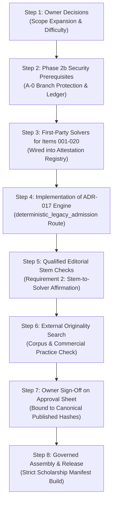

# Numerical Reasoning: 40-Question Critical-Path Release Plan

> **Notice:** This document contains independent AI-generated advisory analysis by Antigravity (Google DeepMind). It is **not qualified human approval** and conveys no authorization to publish or deploy.

---

## 1. The Core Release Constraint

MindMosaic delivery architecture enforces a **fail-closed, complete-paper invariant** for all scholarship offerings:
- A Year 6 Numerical Reasoning examination requires **exactly 40 approved questions**.
- The delivery engine (`src/features/exam-engine/selection/select-questions.ts`) strictly refuses partial papers, shortened modules, or mixed-section draws.
- If even 1 of the 40 questions is unapproved, missing, or rejected by publication gates, `/exams/scholarship-y6-numerical-reasoning-full` returns `insufficient_questions` and remains completely unavailable to students.
- **Therefore, Numerical Reasoning cannot launch in increments.** All 40 items must become simultaneously eligible and approved.

---

## 2. Current Status of the 40 Questions

| Status Dimension | Status Fact | Impact on Release |
|---|---|---|
| **Answer Correctness** | 40 of 40 verified by first-party recompute (021–040) or closed-language solvers (001–020). | Arithmetically sound; 0 defects found. |
| **Ambiguity / Stem Integrity** | 40 of 40 have unique solutions; `nr-022` flagged for weak relational binding (requires human editorial affirmation). | Ready for human editorial review. |
| **Difficulty Gate** | **26 pass**, **14 blocked** by estimator deviation. | Requires owner decision on 14 items (4 relabels recommended: `nr-003`, `nr-005`, `nr-007` to easy; keep remaining 11). |
| **Provenance & Governance Hold** | **40 of 40 blocked** under Phase 1 legacy-import hold (`originalGeneration: unverified`). | Cannot publish under existing gates. |
| **ADR-017 Initial Scope** | Only **2 items** (`nr-022`, `nr-023`) are in initial engineering scope; **1 item** (`nr-001`) is conditional; **37 items** are outside scope. | **Numerical Reasoning CANNOT launch without an owner decision expanding ADR-017 scope to all 40 items AND implementing Phase 2b.** |
| **Human Approvals** | **0 of 40 approved.** | No qualified human has reviewed or signed any item. |

---

## 3. The 8 Critical Steps to Production Readiness



### Step 1: Owner Authorisations & Scope Expansion (Owner Action)
1. **Scope Expansion Decision:** Formally expand the `deterministic_legacy_admission` route beyond the 5 initial items in PR #73 to cover all 40 Numerical Reasoning items.
2. **Difficulty Resolution:** Decide the 14 blocked items using `docs/reviews/scholarship-2026-10-18/NUMERICAL-40-OWNER-REVIEW.md`:
   - Relabel `nr-003`, `nr-005`, `nr-007` to `easy` (re-pinning candidate hashes).
   - Confirm declared labels for the remaining 11 items.

### Step 2: Phase 2b Security Prerequisites (Engineering & Owner)
1. **GitHub Branch Protection (A-0):**
   - Add `scholarship-drafts` to required checks on `dev` and `main`.
   - Configure strict branch up-to-date enforcement and admin enforcement.
2. **Workstream A:** Implement authenticated human approval architecture (Ed25519 or SSH commit signatures bound to verified signers).
3. **Workstream B:** Implement the immutable legacy-origin ledger.

### Step 3: Implement Genuine First-Party Recomputes for Items 001–020 (Engineering)
Currently, items 001–020 use parameter-driven closed-language solvers. Under ADR-017 §1.2, to qualify for first-party attestation:
1. Extend `SCHOLARSHIP_ATTESTED_SKILLS` to include `nr-number-series` and `nr-number-matrices`.
2. Register independent first-party solvers in `SCHOLARSHIP_FIRST_PARTY_SOLVERS` declaring their own givens for all 20 items.
3. Write comprehensive unit tests for each new solver entry.

### Step 4: Implement the `deterministic_legacy_admission` Route (Engineering)
1. Create the admission gate in `src/features/question-factory/governance/legacy-admission.ts`.
2. Enforce the 6 mandatory evidence requirements from ADR-017 §3:
   - First-party recompute (D2-bound).
   - Editorial stem check.
   - Exact D1, D2, D3 hash bindings.
   - Originality assessment record.
   - Age-suitability affirmation.
   - Authenticated approval signature.

### Step 5: Conduct Qualified Human Editorial Checks (Human SME Action)
A named qualified educator / editor must examine all 40 stems against displayed options and solvers, affirming:
- The solver's assumptions match the stem's language.
- The conditions are exhaustive and admit no second defensible reading.
- Pay specific attention to `nr-022` (relational factors in prose).

### Step 6: External Originality Assessment (Human SME / Tooling)
Execute external originality verification against Australian curriculum test repositories and commercial scholarship practice sets to confirm no questions are derivative.

### Step 7: Record Formal Human Approvals (Owner Action)
The repository owner reviews the 40 items in `review-sheet-scholarship-y6-nr.html` and executes:
```bash
npm run questions:publish -- \
  --candidate-ids $(cat docs/reviews/scholarship-2026-10-18/nr-40-ids.txt) \
  --sheet docs/reviews/scholarship-2026-10-18/review-sheets/review-sheet-scholarship-y6-nr-signed.csv \
  --reviewer "Vishwas Joshi"
```
The tool validates that every row matches the canonical D3 published hash and revision 0.

### Step 8: Governed Assembly & Release Verification (Engineering)
1. Run strict scholarship assembly:
   ```bash
   npm run questions:assemble-scholarship
   ```
2. Verify:
   - Exactly 40 questions assembled into `content/question-factory/published-manifests/batch-scholarship-published.json`.
   - `src/tests/unit/scholarship-availability.test.ts` transitions Numerical Reasoning from "coming soon" to "live".
   - `src/tests/unit/scholarship-session-route.test.ts` passes.
3. Full verification suite green (`npm run typecheck`, `npm test`, `npm run test:rls`).
4. PR into `dev` merged by repository owner.

---

## 4. Work That Can Proceed in Parallel with AMC PR #76

While Claude Code completes AMC PR #76:
- The owner can review and fill the blank decision fields in `NUMERICAL-40-OWNER-REVIEW.md`.
- Phase 2b design specifications (Workstream A & B) can be prepared in dedicated documentation worktrees.
- The external provider review of Verbal Reasoning and Reading can be executed via ChatGPT / Gemini.
- Zero conflicts will occur because all scholarship content is completely decoupled from AMC files.
